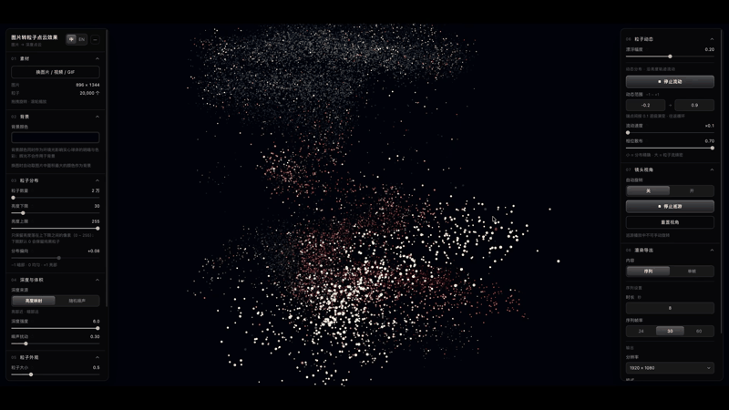
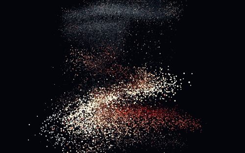
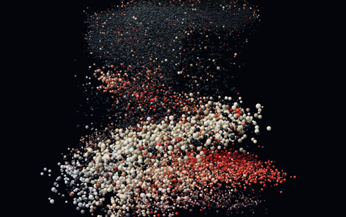

# Image → Particle Point Cloud

[中文](README.md) | **English**

Turn any image into an **interactive 3D particle point cloud**. Pure front-end, single file, no
upload — your image is processed entirely in your own browser.

**Live demo**: <https://afeiisfine.mindpion.workers.dev/>



> **A note from the author**: I'm **阿飞这个名字挺好的** (["AfeiIsFine"](https://github.com/AfeiIsFine) —
> literally "this name Afei is quite nice"). I don't know how to program. Every line of code, every
> feature — and this document — was written by AI. Please forgive any amateurish mistakes, and feel
> free to open an Issue if you spot one.
>
> **For English readers**: the source code is commented in Chinese. The UI has a built-in
> Chinese/English switch, but code comments were not translated. This English README is a
> condensed version — the [Chinese README](README.md) covers everything in more depth.

---

## What it is

A web tool built with three.js. Drop in an image and it samples the picture into tens of
thousands of 3D particles based on pixel brightness. It reads the **largest-area colour** to
decide whether the background is dark or light, then configures a whole set of parameters for
you — so you see a finished result on open instead of an empty scene.

Two particle forms:

| Form | What it is | Good for |
|---|---|---|
| **Soft glow dots** (default) | Round dots with soft edges, using a *depth prepass* for occlusion: the opaque core of a near particle hides the ones behind it while the edges stay soft | Atmosphere, abstract, glow |
| **Solid spheres** | Each particle is shaded as a lit solid sphere — per-pixel spherical depth, baked contact shadows, ACES filmic tone mapping | Objects, sculpture, volume |

Both rendered from the repo's default sample `testpic/black_4.jpg`, same particle count
(50,000) and camera — only the form and size differ (glow dots 0.5 / solid spheres 1.0; the two
forms genuinely have different optimal sizes, since glow dots additively brighten):

| Soft glow dots | Solid spheres |
|---|---|
|  |  |

---

## Getting started

**Just use it** — download `index.html` and open it in your browser (latest Chrome / Edge /
Safari). A sample image loads automatically.

**Serve locally** (for development) — opened as `file://`, the page can't read `testpic/` due to
the same-origin policy and will appear empty. That's not a bug:

```bash
python3 -m http.server 8123
# then open http://127.0.0.1:8123/index.html
```

**Controls** — left-drag to orbit, scroll to zoom, middle/right-drag to pan. The `↺` left of each
slider resets it. The panel has two columns and 7 groups; click a group title to collapse it, or
the `—` at the top-right to hide the whole panel.

**URL parameters** — `?test` (built-in test image) · `?blank` (empty scene) · `?stats=1`
(console sampling stats) · `?dist=` `?lumMin=` `?lumMax=` `?solid=` (pin a parameter) ·
`?bgauto=0` (disable all auto-config)

## Features

- Drag in an **image / video / GIF / folder**; videos and GIFs drive colour and depth in real time
- **Auto-config on image change**: dark background → luminance 30–255 and soft glow dots;
  light background → 0–240 and solid spheres
- Particle distribution (up to **300,000**), size, opacity, lightness, saturation, gloss, bloom,
  gradient background
- Flow animation along luminance bands; camera auto-rotate; **PNG / frame-sequence export**
- **Bilingual UI** with a Chinese/English switch

---

## Measured performance

1440×900 canvas, 20,000 particles, real GPU (ANGLE Metal / Apple M1 Max):

| Scenario | Frame rate | p95 frame time | JS heap |
|---|---|---|---|
| Default 20k · glow dots | 60.0 fps | 18.0 ms | 8.1 MB |
| 100k | 60.0 fps | 18.2 ms | 12.0 MB |
| 300k (slider maximum) | 60.0 fps | 18.3 ms | 21.1 MB |
| Solid spheres 20k | 60.0 fps | 17.3 ms | 8.1 MB |

Flow animation (20k particles × 12 keyframe tracks, Catmull-Rom interpolated on the CPU each
frame): **0.6 – 2.8 ms/frame**.

## Three things worth knowing

**Solid spheres must be opaque.** A semi-transparent pixel written into the depth buffer culls
the particles behind it, leaving only itself blended at very low alpha → every particle gets a
dark halo (measured: 559 isolated black dots vs 0 with the current approach). So solid mode
hard-cuts the silhouette and any pixel writing depth has alpha exactly 1; the "opacity" slider
darkens RGB instead.

**Particle size can't be a constant.** A hard-coded `160.0` in `gl_PointSize` ignored viewport
height, so higher resolutions made particles *smaller*. It now scales by
`drawing buffer height / 1800`, keeping world size constant — preview matches export.

**Export must match the preview.** `EffectComposer` locks its pixel ratio at construction, so
changing only the renderer on export made particles smaller and greyer (coverage ratio 0.492).
Changing both together gives **0.999**.

The [Chinese README](README.md) documents these in full, including the colour-pipeline
double-gamma trap and the flow-animation start-phase bug.

---

## Project structure

```
index.html          Everything: HTML / CSS / shaders / app logic (single file, ~3200 lines)
libs/               three.js r160 + OrbitControls + post-processing (MIT)
testpic/            9 sample images (black_*.jpg dark, white_*.jpg light)
screenshots/        Demo images used by this README
build_share.py      Optional: bundle into a single-file HTML (needs npx / esbuild)
```

**`testpic/black_4.jpg` is the default sample** loaded on page open (filename hard-coded); the
other 8 are for testing replacements. Dark images auto-select soft glow dots, light ones select
solid spheres.

**Tests** live in `.test/` (`node .test/test_sampling.mjs` for algorithm level;
`cd .test/pup && npm i` then `node .test/pup/review_checks.js` for the browser-level regression
guard). `node_modules/` and debug screenshots are not tracked.

## Browser requirements

Requires **WebGL2**. Frame-sequence export uses `showDirectoryPicker`, which needs **HTTPS or
localhost** — satisfied by static hosting by default; unavailable when opened via `file://`.

## License

[MIT](LICENSE) — free to use, modify and use commercially, as long as the copyright notice is
kept. three.js (r160) and its addons under `libs/` are copyright Three.js Authors, likewise MIT;
their copyright headers are preserved.
